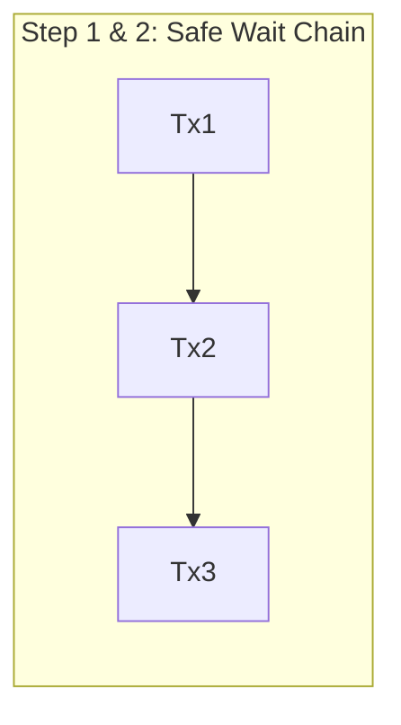
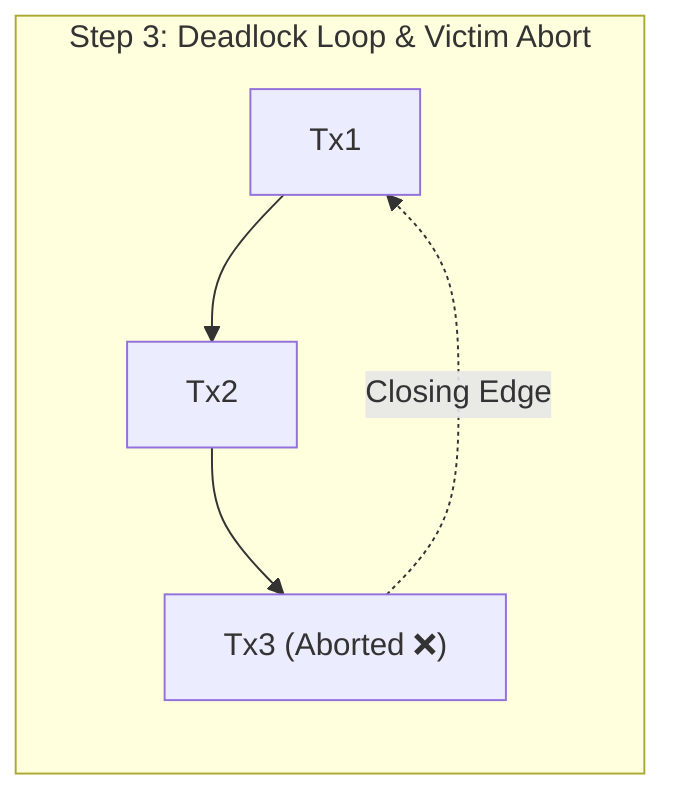

# ⚡ Database Concurrency & Deadlock Resolution Engine

> **Mathematical Foundation for Computer Science (MFCS) Project**  
> **Course Code:** 2CS802CC26 | CSE, Semester 3  
> **Authors:** Shlok Shah (25BCE313) & Shailya Patel (25BCE320)

An API-driven graph engine for detecting and resolving database transaction deadlocks using a **Three-State Depth-First Search (DFS)** on Wait-For Graphs (WFG), served as a high-performance **FastAPI** microservice with **Python** and **C++** test clients.

---

## 📌 Problem Statement & Concurrency Challenges

In high-concurrency database systems, multiple transactions frequently compete for exclusive locks on shared rows and tables:
* **The Deadlock Problem:** Transaction $A$ holds a lock that Transaction $B$ requests, while Transaction $B$ holds a lock that Transaction $A$ requests. Neither can proceed, and queued transactions stall indefinitely.
* **Coffman Conditions:** A deadlock requires four simultaneous conditions:
  1. *Mutual Exclusion*
  2. *Hold and Wait*
  3. *No Preemption*
  4. *Circular Wait*
* **Our Approach:** The engine eliminates the **Circular Wait** condition by modeling dependencies as a directed graph, detecting cycles instantaneously upon lock acquisition requests, and aborting the minimal set of victim transactions.

---

## 📐 Mathematical Formulation & Graph Modeling

The concurrency state is modeled as a directed **Wait-For Graph (WFG)**:

$$\mathcal{G} = (V, E)$$

* **Vertices ($V$):** Active transactions ($\{Tx_1, Tx_2, Tx_3, \dots\}$).
* **Directed Edges ($E$):** Resource dependency states. An edge $Tx_A \to Tx_B$ signifies that $Tx_A$ is blocked and waiting for a resource held by $Tx_B$.
* **Fundamental Theorem:** A deadlock exists in the database if and only if $\mathcal{G}$ contains one or more directed cycles. If $\mathcal{G}$ is a Directed Acyclic Graph (DAG), all transactions are guaranteed to terminate safely.

### In-Memory Graph Representation
The engine maintains the WFG as an adjacency list:
```python
self.wfg: Dict[str, Set[str]] = {
    "Tx1": {"Tx2"},
    "Tx2": {"Tx3"},
    "Tx3": set()
}
```
* Using a hash map of hash sets guarantees $O(1)$ edge insertions and automatic duplicate rejection.
* Total space complexity: $\mathcal{O}(V + E)$.
* Self-wait requests ($Tx_A \to Tx_A$) are caught and rejected immediately with `HTTP 400 Bad Request`.

---

## 🔍 Cycle Detection: Three-State DFS ($\mathcal{O}(V + E)$)

Instead of naive cycle search or high-overhead matrix multiplications, the engine applies a **Three-State Depth-First Search**:

| State | Status | Meaning |
| :---: | :---: | :--- |
| **`0`** | **Unvisited** | Node has not yet been explored in this search pass. |
| **`1`** | **Visiting** | Node is currently on the active DFS recursion stack. |
| **`2`** | **Visited** | Exploration of the node and all its subtrees is complete (no cycles through it). |

### Algorithm Walkthrough
1. Traversal starts at each unvisited vertex ($state = 0$), transitioning it to $state = 1$ and appending it to the traversal path.
2. If an edge encounters a neighbor in **State 1**, a **back-edge** is identified, confirming a directed circular wait.
3. The exact cycle is sliced from `path[cycle_start_index:]`.
4. If no back-edge is found, the node is marked **State 2** and popped from the path.
5. Because every vertex and edge is visited at most once, the time complexity is strictly bounded by:

$$\mathcal{O}(V + E)$$

---

## 🛡️ Victim Resolution Policy

When a circular wait is detected:
1. **Victim Selection:** The engine designates the last transaction in the detected cycle path as the victim (`victim = cycle[-1]`).
2. **Pruning & Abort:** `remove_transaction(victim)` deletes the vertex and scrubs all associated incoming and outgoing wait dependencies from neighbor adjacency sets.
3. **Iterative Resolution:** `check_and_resolve()` executes in a loop until no cycles remain, ensuring that complex topologies with multiple interconnected deadlocks are completely resolved before unblocking survivors.

---

## 🌐 FastAPI Microservice Architecture

The engine is encapsulated in a RESTful microservice powered by **FastAPI** and **Uvicorn**, featuring strict validation via **Pydantic v2**:

### Endpoints

| Method | Endpoint | Description | Request Body |
| :--- | :--- | :--- | :--- |
| `POST` | `/request-lock` | Registers a lock wait edge ($requester \to holder$), executes cycle detection, and aborts victims if a cycle forms. | `{"requester": "Tx1", "holder": "Tx2"}` |
| `GET` | `/graph` | Returns the current Wait-For Graph adjacency list. | *None* |
| `DELETE` | `/reset` | Flushes the engine and re-initializes an empty graph state. | *None* |
| `GET` | `/docs` | Interactive Swagger UI documentation and live testing sandbox. | *None* |

---

## 🧪 Simulation & Multi-Language Clients

### Demonstration Scenario:
1. $Tx_1 \to Tx_2$ *(Chain, Safe)*
2. $Tx_2 \to Tx_3$ *(Chain, Safe)*
3. $Tx_3 \to Tx_1$ *(Closes circular loop $\to$ Deadlock detected!)*
4. Engine catches deadlock, aborts $Tx_3$, and restores a conflict-free DAG: $\{Tx_1 \to Tx_2\}$.





---

## 🚀 Setup & Execution Guide

### 1. Prerequisites
- Python 3.10+
- C++14+ compiler (optional, for C++ test client)

### 2. Installation
Clone the repository and install the dependencies:
```bash
git clone https://github.com/ShlokShah2007/Deadlock-Resolution-Engine.git
cd Deadlock-Resolution-Engine
pip install -r requirements.txt
```

### 3. Launching the Engine Server
Run the FastAPI application with Uvicorn:
```bash
python -m uvicorn app:app --reload
```
The server will start at `http://127.0.0.1:8000`. You can explore the interactive API docs at `http://127.0.0.1:8000/docs`.

### 4. Running the Python Test Client
In a separate terminal:
```bash
python test_client.py
```

### 5. Running the C++ Test Client
Compile and run the C++ client to verify language-agnostic HTTP interaction:
```bash
g++ -std=c++14 test_client.cpp -o test_client
./test_client
```
*(On Windows: `g++ -std=c++14 test_client.cpp -o test_client.exe` then `.\test_client.exe`)*

---

## 📂 Project Structure

```text
Deadlock-Resolution-Engine/
├── app.py              # FastAPI server & DeadlockEngine with Three-State DFS
├── test_client.py      # Automated Python simulation client
├── test_client.cpp     # Cross-language C++ HTTP test client
├── requirements.txt    # Pinned production dependencies
├── 25BCE313-25BCE320 MATHS ASSIGNMENT.pptx # Project presentation slide deck
└── README.md           # Mathematical documentation and architecture specification
```

---

## 📊 Presentation Slide Deck

The official coursework presentation slides are included directly in this repository:
* **[`25BCE313-25BCE320 MATHS ASSIGNMENT.pptx`](./25BCE313-25BCE320%20MATHS%20ASSIGNMENT.pptx)**: Covers the full problem statement, Coffman conditions, Wait-For Graph theoretical model, 3-state DFS back-edge detection, FastAPI microservice design, and benchmark results.


---

## 📄 License & Academic Integrity

This project is developed for academic evaluation under the **Mathematical Foundation for Computer Science (MFCS)** curriculum. Feel free to reference and adapt with appropriate attribution.
